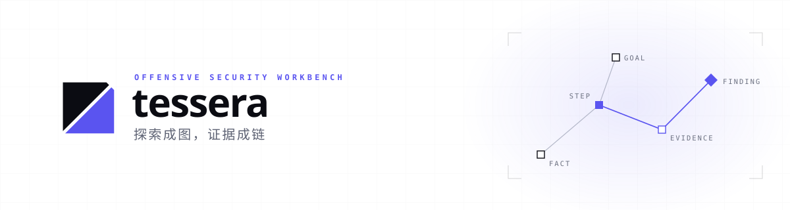

<picture>
  <source media="(prefers-color-scheme: dark)" srcset="docs/assets/tessera-banner-dark.svg">
  
</picture>

# Tessera

[](https://github.com/kksty/Tessera/actions/workflows/checks.yml)
[](https://github.com/kksty/Tessera/actions/workflows/images.yml)

**探索成图，证据成链。** 一个采用 FGS（Fact / Goal / Step）的模型驱动安全测试工作台：模型通过共享图协调探索，保存原始证据，由独立上下文审核候选发现，人负责授权与最终复核。

没有固定攻击流程、专家角色或 skill 系统；Decide / Execute / Review 是三类任务，行为由提示词驱动。

> [!WARNING]
> 本项目是实验性安全测试工具，仅用于**明确获准的隔离环境**。Worker 会执行真实命令；Dispatcher 持有 Docker Socket；容器不能提供完整安全隔离。模型结果需要人工核实，证据与上下文可能发送给配置的模型服务。本项目不提供多租户隔离或生产可靠性保证。使用者对授权范围、数据保护和实际操作负责。

## 快速开始

需要 Docker Compose v2、Linux 容器及可用的模型 API。

```sh
docker compose up -d
```

首次启动会从 GHCR 拉取预构建镜像（Worker 含 Kali 工具链，压缩后约 1.5 GB），之后复用本地缓存。预构建镜像当前为 `linux/amd64`，其他架构请从源码构建。

打开 [http://127.0.0.1:8000](http://127.0.0.1:8000)。登录凭据留空时首次启动自动生成，在 `docker compose logs tessera-server` 中打印一次；登录后在设置页配置模型。

默认配置即可启动。需要修改端口、数据目录、登录凭据或模型时：

```sh
cp .env.example .env          # PowerShell：Copy-Item .env.example .env
# 编辑 .env 后重新执行
docker compose up -d
```

升级镜像：

```sh
docker compose pull
docker compose up -d
```

平台数据默认保存在 `./datas/tessera`，`docker compose down` 不会删除它；命名卷模式见[项目说明](docs/project.md)。如果 GHCR 上尚未发布对应版本（例如刚 fork），请使用下方的源码构建命令。

## 能力

- 跨项目风险总览、漏洞库、探索图与时间线。
- 自主规划、并行执行、独立审核与 CVSS v4.0 评分。
- 资产审批、Hint 指令、任务关闭与重开。
- 原始证据、HTTP/HTTPS 录制、项目文件、报告及诊断导出。
- 持久工作区、长命令会话和原键结果补交。
- 按 surface 的完成覆盖表、执行线索（Lead）和审核问题处置。

## 工作方式

Tessera 把一次探索外化为一张只追加的 FGS 图：

- **Fact** 记录已确认的世界状态和原始证据。
- **Goal** 表达完成条件，可动态增删子目标。
- **Step** 是要回答的可证伪问题。
- **Finding** 是搜索过程中产生的、需要独立审核的结论。
- **Lead** 是执行阶段发现的下一问题，未落实或豁免时阻止完成。

Decide 规划与结算图，Execute 执行真实命令并提交 Fact，Review 用独立上下文审核证据与分类。模型通过 HTTP API 与平台交互，Worker 容器由 Dispatcher 动态创建。

## 文档

- [文档索引](docs/README.md)
- [项目说明](docs/project.md)：当前架构、任务契约、部署维护、验证边界与后续工作。
- [运行、归档与升级](docs/operations.md)：凭据边界、保留策略、一致性备份和升级注意事项。
- [容器镜像与 GHCR](docs/containers.md)：镜像发布、标签、公开包设置和 Registry 覆盖。
- [安全策略](SECURITY.md) / [贡献指南](CONTRIBUTING.md)
- 设计背景：[从 Cairn 到 FGS](docs/background/cairn-ai-pentest-architecture.md)

## 开发

Node.js 24+，pnpm 版本以 `package.json` 为准。

```sh
pnpm install --frozen-lockfile
pnpm dev                    # API
pnpm dev:web                # 另一终端启动前端
pnpm typecheck
pnpm lint
pnpm format:check
pnpm test
pnpm test:traffic            # Python 3，流量组件测试
pnpm build
```

从源码构建容器镜像：

```sh
docker compose -f compose.yaml -f compose.build.yaml up -d --build
```

## 容器镜像

镜像由 [`.github/workflows/images.yml`](.github/workflows/images.yml) 在推送 `v*` 标签或手动触发时构建并推送到 GHCR：

- `ghcr.io/<owner>/tessera-server:<version>`：Server 与 Dispatcher。
- `ghcr.io/<owner>/tessera-runtime:<version>`：项目 Worker 运行时。

`compose.yaml` 默认使用 `ghcr.io/kksty` 与 `0.3.0`；可用 `TESSERA_IMAGE_REPO` / `TESSERA_IMAGE_TAG` 切换。首次发布后需在 GitHub Packages 中把两个包设为 public，公开仓库的用户才能免登录拉取。发布新版本时同步更新 `package.json`、`.env.example` 中的 `TESSERA_IMAGE_TAG` 和 `compose.yaml` 的默认标签。

GHCR（GitHub Container Registry）是 GitHub 提供的容器镜像仓库，公开包可匿名拉取，适合存放本项目的预构建镜像；也可以把 `TESSERA_IMAGE_REPO` 指向 Docker Hub 或自建 Registry。

## 安全边界

- 只对明确授权的资产使用；不要把本项目暴露到不受信任的网络。
- Dispatcher 需要 Docker Socket，Worker 以 root 运行并需要网络能力；这些是高权限运行条件，不是安全边界。
- 模型 API Key、证据、流量和会话可能含敏感数据；按实际数据权限保护 `datas/`、项目工作区和导出文件。
- 发现项目自身漏洞请按 [SECURITY.md](SECURITY.md) 私下报告，不要在公开 Issue 中披露利用细节。

## 许可与致谢

问题建模参考 [oritera/Cairn](https://github.com/oritera/Cairn)。许可：[AGPL-3.0](LICENSE)，保证排除与责任限制以许可原文为准。
