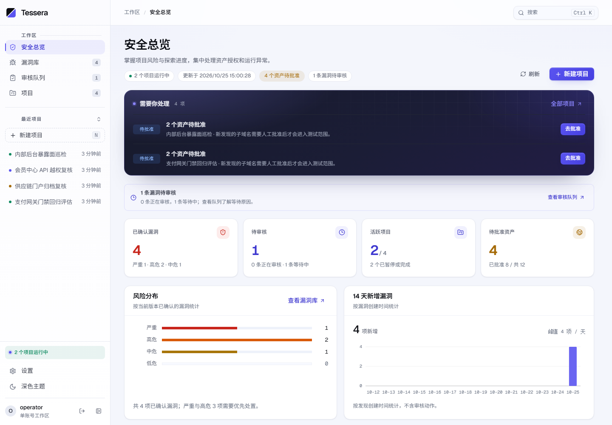
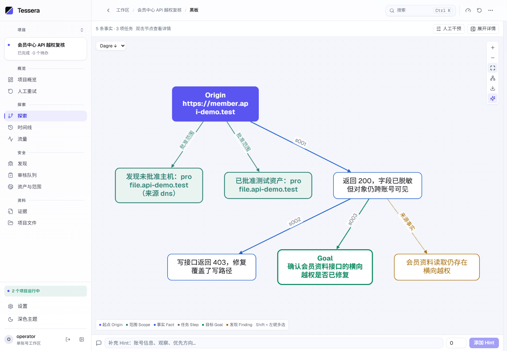
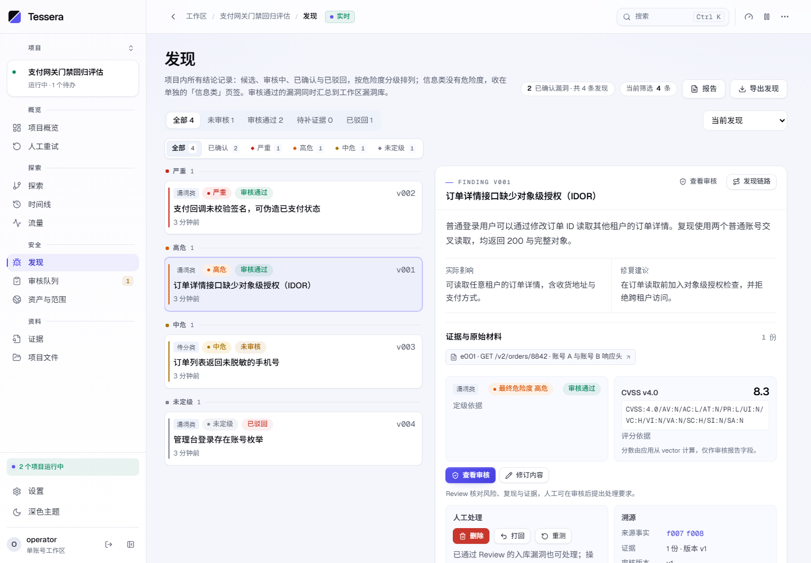
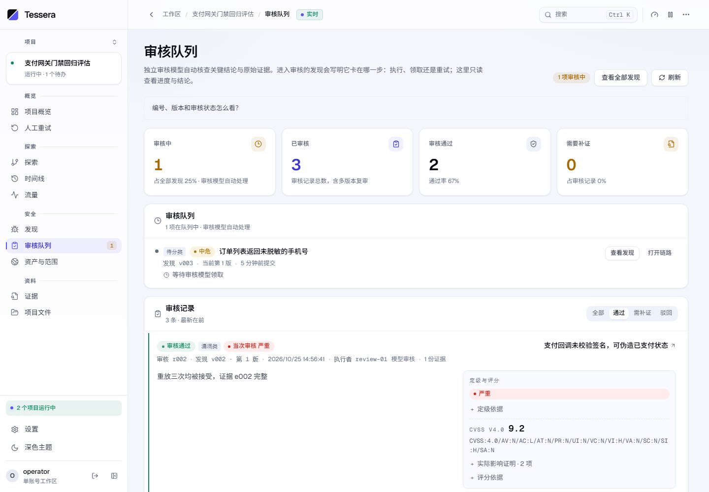

<picture>
  <source media="(prefers-color-scheme: dark)" srcset="docs/assets/tessera-banner-dark.svg">
  
</picture>

# Tessera

[](https://github.com/kksty/Tessera/actions/workflows/checks.yml)
[](LICENSE)

**探索成图，证据成链。** Tessera 是一个模型驱动的自主安全测试工作台：模型在共享图上规划、渗透与审核，渗透的原始证据随图保留、可回查，人负责授权与最终判断。

没有固定的攻击流程，也没有预设的专家角色。Tessera 提供两种**并行**的任务架构：决策者架构（Decide / Execute / Review，单一规划入口）与蜂群架构（Swarm，平等执行者，无决策者/无 Step）。两者按项目隔离、创建时选定，不是新旧版本；详见 [两种并行架构](docs/architectures.md)。

> [!WARNING]
> 本项目是实验性安全测试工具，仅用于合法合规、事先获准的环境。Worker 会执行真实命令，模型结论需要人工核实；证据与上下文可能发送给配置的模型服务。Dispatcher 持有 Docker Socket，Worker 与网关以高权限运行，本平台不是对抗恶意提示或恶意代码的隔离边界。使用者对自身的使用行为、数据保护和实际操作负责。

## 快速开始

需要 Docker Compose v2、Linux Docker Engine（建议 28+，网关的 isolated 网络需要；Docker Desktop 的 Linux 容器也可运行）和可用的模型 API。镜像在本机构建，首次构建会装入 Worker 的 Kali 工具链，明显慢于后续启动。

```sh
docker volume create tessera-data
docker compose up -d
```

打开 [http://127.0.0.1:8000](http://127.0.0.1:8000)。登录凭据留空时首次启动自动生成，只在 `docker compose logs tessera-server` 打印一次；登录后在设置页配置模型。

平台数据固定放在命名卷 `tessera-data`（可用 `TESSERA_DATA_VOLUME` 改名）：Compose 不创建也不删除它，`docker compose down -v` 同样不会。首次部署必须先执行 `docker volume create`。

默认配置即可启动。要改监听地址、端口、卷名、登录凭据或模型：

```sh
cp .env.example .env          # PowerShell：Copy-Item .env.example .env
# 编辑 .env 后重新执行
docker compose up -d
```

`TESSERA_PORT` 默认 `8000`；`TESSERA_BIND_ADDRESS` 默认 `127.0.0.1`（仅本机），需要局域网访问时改为 `0.0.0.0`，并自行处理防火墙与 HTTPS。完整变量见 [`.env.example`](.env.example)。

更新到最新代码：

```sh
git pull
docker compose up -d --build
```

`--build` 按当前代码重建镜像；旧项目的 Worker 会在任务排空后按新镜像重建，升级前先确认没有在途任务。回退时把 `.env` 的 `TESSERA_IMAGE_TAG` 换成旧标签，再执行 `docker compose up -d`（不重建）。细节见[容器镜像](docs/containers.md)；备份见[运行、数据归档与升级](docs/operations.md)。

## 界面

以下截图使用本地演示数据（`.test` 域名）生成，展示工作区总览、探索图、发现详情与审核记录。



**安全总览**：跨项目汇总已确认漏洞、待审核发现和待批准资产。



**探索黑板**：Fact、Goal、Step、Finding 与证据以因果链相连，可随时回放。



**发现与评分**：结论保留审核状态、原始证据和 CVSS v4.0 定级。



**审核记录**：独立上下文给出通过、需补证或驳回，并留下定级依据。

## 工作方式

Tessera 把一次探索外化为一张只追加的 FGS（Fact / Goal / Step）图：

- **Fact**：已确认的世界状态和原始证据。
- **Goal**：完成条件，可动态增删子目标。
- **Step**：要回答的可证伪问题。
- **Finding**：搜索过程中产生的、需要独立审核的结论。
- **Lead**：执行阶段发现的下一问题；它只是候选线索，不阻塞完成，值得追的由 Decide 用新 Step 落实，不值得的在 `lead_dispositions` 说明理由。

Decide 规划与结算图；Execute 执行真实命令并提交 Fact；Review 用独立上下文审核证据与分类。模型通过 HTTP API 与平台交互，Worker 容器由 Dispatcher 动态创建。

每个项目由 Dispatcher 自动创建独立网关和隔离网络：Worker 没有直连出口，HTTP/HTTPS 由网关透明接管并归档，VPS 上还可以按项目分配回连端口。详见[项目出口与回连](docs/network-gateway.md)。

## 能力

- **探索与图**：跨项目风险总览、漏洞库、探索图与时间线。
- **执行**：自主规划、并行执行、持久工作区、长命令会话、原键结果补交。
- **审核**：独立上下文审核、CVSS v4.0 评分、审核问题处置与 Lead 处置。
- **链路**：`key` + `depends_on` 在同一轮规划有序 Step；前置未产出时不领取后继，适合多步利用链而非并行枚举。
- **经验复用**：Execute 可检索本任务其他 Run 的工具调用过程；命中是线索、不是证据，引用前须回读原件或复现。
- **证据**：被黑板引用的原始证据、HTTP/HTTPS 录制、项目文件、报告及诊断导出。
- **人工控制**：资产审批、Hint 指令、任务关闭与重开；审核问题的豁免是可选捷径，模型可带理由自行处置。
- **覆盖**：按 surface 的完成覆盖表，不用百分比或漏洞数量代替完成判断。
- **可搬移**：单项目完整备份——图、事件、Run/诊断日志、流量正文与证据原件打包为 ZIP，可在另一实例按原 ID 导入继续工作。

## 文档

- [文档索引](docs/README.md)
- [项目说明](docs/project.md)：当前架构、任务契约、部署维护、验证边界与后续工作。
- [两种并行架构](docs/architectures.md)：决策者架构与蜂群架构的定位、开单方式与选择建议。
- [运行、归档与升级](docs/operations.md)：凭据边界、保留策略、一致性备份和升级注意事项。
- [容器镜像](docs/containers.md)：本地构建、标签、更新、回退和 Registry 覆盖。
- [项目出口与回连](docs/network-gateway.md)：独立网关、VPS 回连端口、HTTP/HTTPS 采集与实测步骤。
- [贡献指南](CONTRIBUTING.md)
- 设计背景：[从 Cairn 到 FGS](docs/background/cairn-ai-pentest-architecture.md)

## 开发

Node.js 24+，pnpm 版本以 `package.json` 为准。

```sh
pnpm install --frozen-lockfile
pnpm dev                    # API
pnpm dev:web                # 另一终端启动前端
pnpm typecheck
pnpm lint
pnpm format:check
pnpm test
pnpm test:traffic           # Python 3，流量组件测试
pnpm build
```

构建容器镜像（与快速开始相同）：

```sh
docker compose build
```

## 容器镜像

本项目不发布预构建镜像；`compose.yaml` 从当前源码在本机构建三个镜像：

- `tessera-server:<tag>`：Server 与 Dispatcher（同一镜像，不同命令）。
- `tessera-runtime:<tag>`：项目 Worker 运行时，含 Kali 工具链。
- `tessera-gateway:<tag>`：每项目独立出口、HTTP/HTTPS 采集与入站回连。

```sh
docker compose build          # 只构建
docker compose up -d --build  # 构建并启动，代码更新后使用
```

`TESSERA_IMAGE_TAG`（默认 `latest`）只是本地镜像标签，用于区分和回退版本；它不是 Registry 地址。构建参数（Debian/Kali 镜像源、npm registry）、`TESSERA_WORKER_TARGET=full` 和更新流程见 [`.env.example`](.env.example) 与[容器镜像](docs/containers.md)。

如果你自己把镜像推送到 Registry，用 `TESSERA_APP_IMAGE` / `TESSERA_WORKER_IMAGE` 指定完整引用；两者必须同版本。

## 免责声明

- 本项目按「现状」提供，不附带任何明示或默示的保证，包括但不限于可用性、完整性及特定用途适用性。
- 模型输出与自动化流程可能产生错误、遗漏或不完整的结论；请自行复核后再据以行动。
- 使用本项目产生的一切后果由使用者自行承担，请确保使用行为符合适用法律、合同约定与组织政策。
- 第三方组件、工具链与镜像遵循各自的许可与条款，相关问题请联系对应上游。
- 许可条款中的保证排除与责任限制以 [LICENSE](LICENSE) 原文为准。

## 许可与致谢

问题建模参考 [oritera/Cairn](https://github.com/oritera/Cairn)。许可：[AGPL-3.0](LICENSE)，保证排除与责任限制以许可原文为准。
