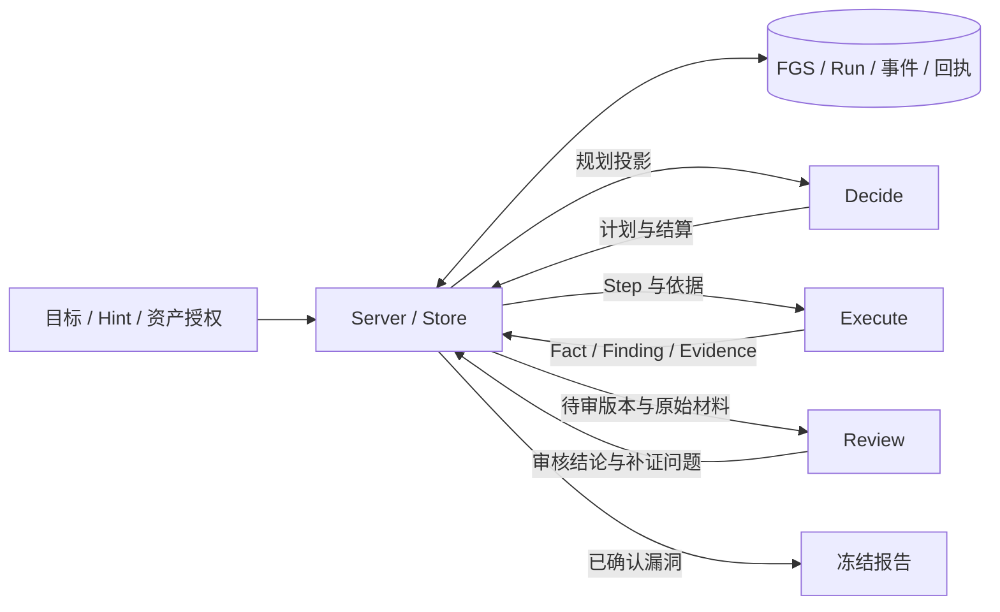

# Tessera 项目说明

本文维护当前实现、运行边界和后续工作。简介与启动见 [README](../README.md)，配置字段见 [.env.example](../.env.example)，提示词以源码为准。设计取舍见[架构与目录](#架构与目录)，M6 归档与历史发布边界见[验证状态与后续工作](#验证状态与后续工作)；历史材料不替代本文的当前说明。

2026-10-20 整体复核结论：现有架构可以继续承载当前单操作员、共享项目与 Docker Worker 的工作台，未发现需要先重做架构才能完善功能的阻断问题。M0、M1、M1D、M2、M3、M4、M5 已完成；接下来以现有功能、协议一致性、异常恢复和代码维护为主。该结论来自当前源码、既有运行材料及本地回归，不表示已证明高并发、大项目或多租户适用性。

M6 是模型效果对照验证，与正式报告交付分属不同事项。原有 9 次小集与 3 次追加对照按结论不足归档，当前暂缓扩展，不作为功能完善的前置条件。2026-10-20 最新业务项目已完成独立审核和自动收尾，可补充真实运行证据；它跨越多个构建且没有配对基线，不能替代 M6 的重复对照。后续针对具体缺陷使用已配置 GLM 做隔离验证，不自动重开整套 M6。

## 架构与目录

Tessera 用一张 FGS 图保存共享业务状态。模型每次在独立上下文中读取投影，通过图提交决定或观测；共享工作区承载文件。没有固定专家身份、攻击阶段机或模型间聊天通道；任务只使用 Tessera 自带的提示词与环境说明，不加载项目工作区的 Pi 资源，不构成固定专家调度层。



Server / Store 是业务状态的统一写入入口；Dispatcher 负责领取、启动和取消项目 Worker。决策者架构中 Decide、Execute、Review 共用 Runner / Pi 会话机制，使用各自投影、提示和工具；swarm 中 peer 回合同样走 Runner / Pi，但使用 peer 投影、消息与 swarm 工具。Review 的补证问题先进入图，再由 Decide 判断后续 Step；授权、越权、IDOR、个人信息类问题带风险标签，但完成前只需逐条 addressed/waived，不要求人工审批。FGS 保存业务状态，工作区保存运行产物，Pi 会话保存单次 Run 的上下文，三者各有用途。

关键取舍：保留 Pi 完整会话 SDK 负责单 Run 的消息、压缩、协议与重试，Tessera 只控制任务提示词、资源加载、工具权限与业务状态，不重写 Agent Loop，也不修改 Pi 包源码；新增能力通过既有图工具表达，不引入专家调度层或任意 Finding Schema 引擎。[Cairn 背景文章](background/cairn-ai-pentest-architecture.md)用于校准搜索机制，不是必须逐项照搬的产品规范；其中的榜单与“0 RAG”等表述只代表作者报告，不构成本平台的效果结论。节点删除是 Decide 的通用规划动作，不设白名单、Hint 前置、人工确认或 Review 审批；服务端只保证引用、运行状态与事务一致，不替模型裁决删除是否明智。发现删除只是可见性标记，操作者可随时从删除历史恢复原 ID 和原版本；Fact、Step 与子 Goal 只保留历史。

| 目录                | 职责                                                                                                                                            |
| ------------------- | ----------------------------------------------------------------------------------------------------------------------------------------------- |
| `apps/server`       | Fastify API、登录、配置与 Web 静态资源                                                                                                          |
| `apps/dispatcher`   | 领取任务、管理 Docker Worker、工作区与资源清理                                                                                                  |
| `apps/web`          | React 工作台；页面、组件和样式分别组织                                                                                                          |
| `packages/protocol` | `schemas.ts` 定义输入校验，`models.ts` 定义共享类型，`graph-relations.ts` 统一来源与类型关系，`index.ts` 统一导出                               |
| `packages/core`     | `store.ts` 管事务与图写入；`decisions.ts` 管决策提交；`history.ts` 管历史、冷热与分页；其他文件分别管投影、检索、审核评分、报告、流量和运行记录 |
| `packages/runner`   | Pi 会话、工具、提示词、进程、用量、结果提交与恢复                                                                                               |
| `packages/models`   | 共享 Pi 供应商、模型目录、运行配置解析与压缩设置；供设置检测和 Runner 共用                                                                      |
| `docker/tools`      | 工具安装、环境提示与一份按需运行时参考                                                                                                          |
| `docker/traffic`    | mitmproxy 录制、HTTP 代理路由与包装器                                                                                                           |
| `scripts`           | 构建、测试入口、提示词导出；`checks/` 放专项验收                                                                                                |
| `tests`             | 按 core、server、runner、dispatcher、web、traffic 分类；helpers 与 fixtures 共享测试材料                                                        |
| `docs`              | 本文与 README 使用的图片                                                                                                                        |

项目由根目录统一管理依赖和构建，源码目录不是独立发布包。Node.js ≥24 + TypeScript ESM；流量录制保留 Python。前端使用 React / Vite，后端使用 Fastify 和内置 SQLite。

## 图与任务契约

- **Fact** 保存观测、结论、状态与 Evidence 引用，证据 ID 放 `evidence_ids`。负面结论（`status: not_observed`）还必须写 `request`（method/url）、`parameter_sources`（参数值来自页面 JS、AJAX、meta、表单或猜测，附证据 ID）与 `negative_scope`（`attempted` 试过什么、`not_tested` 没覆盖什么、`confidence=low/medium/high`）。`not_observed` 只表示该范围内未观测到，不等于“已证伪/已穷尽”；缺范围或溯源的提交在写入时被拒绝，Review 应判断是否把单次未观测误当作方向穷尽；程序不以关键词代替语义判断。Fact 提交不接受 `from`；Step / Finding 的 `from` 只引用 Fact ID。新事实应写简体中文结论（≤120 字）；兼容读取缺失结论时明确标为推断。新观测的 `step_id`、`run_id`、`created_at` 由服务端从租约记录，资产发现生成的 Fact 也保留生产来源；人工观测可有 Step 而没有 Run。生产来源只读取服务端记录的元数据，缺失时保持未知，不从 Step 反推历史归属。
- **Goal** 表达人类根目标或模型子目标。人工改写保留旧文本，并取消基于旧目标的在途 Decide。
- **Step** 是要回答的问题，带来源、资产、子目标、Hint、版本及执行结果引用；新 Step 用 `property` 写一句可证伪的安全属性，`method_hint` 只是建议，执行者仍可自选方法。若 `description` 出现具体命令、HTTP 方法+路径、完整 URL、请求载荷、重复次数或哈希清单，服务端在计划结果里返回**非阻断**的 `warnings`，提示方法应留给执行者，但不会拒绝计划；这是提示，不是新的硬约束。`test_domain`（固定枚举：recon / entry / auth / access / inject / file / config / logic / post / other）与 `focus`（≤20 字）是可选分类标签，只用于黑板分组、筛选与统计，不参与完成、审核、授权或报告入库判定；旧 Step 缺失即「未分类」，不迁移、不回填。Decide 规划新 Step 时填写，人工建单和 `submit_decisions.updates` 可补；黑板节点详情也提供人工补分类入口（`PUT /api/projects/:id/fgs/steps/:step/classification`，事件 `step.classified`）；补分类不改 Step 版本，也不推进规划水位。Decide 的 Step 行只带一个已分类短码 ` [recon]`，Execute / Review 投影不重复。未执行的旧 Step 可在 `updates` 里原位改写 `description` / `property` / `method_hint` / `from`；已执行、运行中或等待人工检查的 Step 不允许改写。新 Step 与未关闭 Step 高度相似时，服务端合并到已有 Step 并保留较完整文本，不建立第二个队列项。执行完成只写 `executed_at`；答够、证伪或放弃由 Decide 或人工关闭，不以百分比或漏洞数量自动判断。
- **Lead** 是执行阶段发现的具体下一问题（`surface`、可选 `parameter`、`why`、`suggested_property`、证据）。它比 Fact 弱、比摘要强，作为一等记录落图，但**只是候选线索、不阻塞完成**：值得追的由 Decide 用新 Step 的 `lead_ids` 落实（受每轮预算约束），不值得的在 `lead_dispositions` 用 `waiver_reason` 说明，其余可以留在图上；同一 `surface` + `parameter` 的 open lead 合并证据，不重复计数。投影只列前 20 条 open lead 并给出 `open_leads_total`。
- **Fact 修订**：已有 Fact 的措辞、统计或 `request` / `parameter_sources` 由 `revise_fact` 原地修订（`POST /fgs/facts/:fact/revisions`），不新建 Step、不唤醒执行者，逐字段把被替换文本存入 `edits`；这是对过去「只读核对 / 生成 successor 事实」记账 Step 的替代。负向观测（`status=not_observed`）的 `request` 与逐参数 `parameter_sources` 在**写入时**校验，缺项直接 422 退回，不再拖到审核阶段。
- **规划预算**：单个 Decide 轮次最多新增 `max_new_steps_per_round`（默认 2）个 Step，在途未关闭 Step 最多 `max_open_steps`（默认 8）；超限的计划被整体拒绝、不落任何节点。近似重复的合并与 `updates` 原位改写不计入新增。**在途上限只约束"增长"、不约束"结算"**：检查只在本轮确实新增 Step 时触发，并按"不含本轮新增"的当前在途数判断；同批 `closes` / `updates.discard` 会在结算时释放的槽位也预先扣除，因此可以在一次提交里边收口低价值 Step 边规划替代问题。只做结算、不新增 Step 的提交永远放行；已被历史推进到上限之上的项目仍可先关闭/放弃排空，不会因每轮被判 422 而耗尽 Decide 重试、最终整项目暂停。Decide 视图的 `limits` 携带本轮真实值、当前在途数与是否到达上限（0 表示不限），提示词不再硬编码具体数字；模型按同一组约束规划，不必用 422 试探。若终局计划被服务端以 4xx（预算、版本、来源无效等）拒绝，Runner 按"规划冲突"释放本轮、不记失败，交下一轮 Decide 重新规划。两值由运行时配置（`TESSERA_MAX_NEW_STEPS_PER_ROUND` / `TESSERA_MAX_OPEN_STEPS`）控制，0 表示不限制。
- **Finding** 保存需要独立管理的结论。`kind=vulnerability|informational|null` 与危险度分开；Execute 可提出分类，Review 通过时必须明确分类。信息类有核查证据即可通过并保留，当前危险度与 CVSS 为空。只有明确漏洞类、当前版本 pass、引用有效原始证据、合法正分 CVSS 和完整影响证明，且未合并/撤回/删除的记录才进入漏洞库、风险分布、漏洞趋势、报告正文及漏洞导出。`finding-policy.ts` 是 Server 与 Web 共用的纯函数契约；不会把“非 informational”反推为漏洞。每个非 N 影响指标用 `impact_evidence` 写明受损对象、安全边界、已证明后果及证据，程序从 vector 算分并复核持久评级；Review 负责判断因果是否成立。
- **Evidence** 是被黑板引用的不可变原件，支持大文件分块。Fact、Finding、Review、资产、Lead 与完成覆盖表引用后才会出现在证据页；工具输出、进程日志、临时文件和未被引用的归档留在项目文件，不作为证据。旧项目已有的未引用归档不删除、不迁移；默认证据页不再列出，显式 evidence ID 仍可读取。证据页正文对显式 Markdown（`text/markdown` MIME 或 `.md` 来源）以及正文呈「两级标题 + 空行分段」的 `.txt`、进程日志默认排版，可切回未渲染原文；渲染保留原始换行与缩进，其他正文默认原文，也可在页内手动渲染。工具栏的 Markdown 渲染开关可整体关闭渲染并保存在本浏览器；HTTP 报文、JSON、HTML 与只有一级 `#` 注释的脚本、清单不按正文猜测格式。路径、摘要、模型会话和工具告警均不能替代证据 ID；新增或修订 Finding 需要重新审核。
- **Hint** 是人的指令，不能当证据。每条有效指令需由当前措辞版本的 Step 落实，或由 Decide 在 `hint_notes` 说明落实方式并关闭 Hint。操作员也可在提示面板（`POST/DELETE /api/projects/:id/hints/:hid/resolve`）确认关闭、重开或撤回。改写或撤回会停止关联的未关闭旧任务，历史事实与旧 note 保留。
- **Run** 记录一次 Decide / Execute / Review 的租约、用量和执行情况。Review 读取已有证据，缺口交给 Decide 规划，不自行扫描。

Worker 发现资产时，由模型判断哪些主机与目标相关并提交为待批准资产；候选一律 `pending`，不按共同域名后缀自动推断归属，也不自动批准。证书域名、外部链接、第三方登录/API 依赖是否登记由模型判断并写明来源与证据，人工批准前不规划、不发起请求；归属与授权始终由人确认。已有低价值或无依据的 Finding 可由 Decide 用 `finding_updates` 的 `withdraw:true` 撤回交付，保留 Fact、证据、原文和审核历史。操作员已批准当前版本的 Finding 不能被 Decide 撤回、合并为来源或删除；需操作员先撤销批准，模型仍可修订为待复审新版本。有独立价值的信息类不能仅因不是漏洞就撤回或争议底层 Fact。获得新支持后，Decide 用同一 ID 的 `restore:true`、理由和实质 `changes` 恢复为新版本复审；同身份补交不会被静默吞掉，也不能通过省略 ID 绕过撤回。所有 Finding 继续使用稳定 `v###` 编号。

审核页将固定发现编号、内容版本和审核编号分别标为“发现 v002”“第 1 版”“审核 r002”，并提供编号及状态说明。历史审核只在节点仍保留上一版快照时展示当时版本的标题与入口，不借用新版本内容；更早版本的正文不再保留，只留审核结论与版本号。“历史审核 · 当前第 2 版”不表示新版已审核通过。数量、去重口径、字段和脱敏状态须回读完整原件核对，重叠分页不相加。

安全总览统一把待审核与已确认条目称为「漏洞」：审核队列计数、首屏状态行和 14 天趋势都按漏洞表述，避免与项目内「发现」页的候选混合。

项目只有一张 `main` 图，续图已移除，决策协议拒绝 `continuation`。持久图必须带 `format_version: 1`；旧格式被拒绝或隐藏，不提供自动迁移。书签只是原节点导航索引，不是事实、授权或调度依据。

决策者架构的项目完成由 Decide 根据 goal、已有证据、未解决问题及剩余工作的价值判断（蜂群架构由全体在岗 peer 共识判定，见下文）；创建项目不再接受 objective / assessment 类型参数。Decide 只通过 `POST /fgs/decisions` 提交计划和结算，旧 `/fgs/decide` 已移除。分类由 `kind` 明确给出，不从旧危险度或评分推断，不提供旧库转换或启动迁移。

人工操作放在项目「发现」的漏洞详情中，黑板只展示和定位。经过 Review 的发现可使用 `POST /findings/:fid/actions` 执行删除、打回或重测，必须带当前 `expected_version`、操作人和说明。删除从当前交付移除，历史证据和报告保留，并可在项目「删除历史」中恢复；打回使当前结论退出漏洞库，交 Decide 修订或补证；重测创建定向 Step，复用原 Finding ID，执行后由 Review 核对新证据。人工操作取消冲突的在途审核，迟到结果不能覆盖人工要求。重测可重新打开已完成项目；暂停状态保持到人工恢复。

报告导出与网页预览共用 view model，统一 CVSS、风险分布、身份、复现与缺项提示。自由文本转义，多行原始证据使用自适应围栏；漏洞通过 Review 前需具备影响、复现步骤和修复建议。诊断接收时间保存在事件 JSON 中，不自动变更已有数据表。

项目内「发现」展示候选、信息类、审核与撤回历史，全局「漏洞库」只显示入库漏洞。`export?format=findings` 导出当前保留发现及分类/复核标记，`format=vulnerabilities` 与漏洞库、风险、报告共用入库条件；完整 JSON/YAML 和时间线继续可作历史导出。整份项目（图、事件、Run 与诊断日志、流量正文、报告快照、证据原件）通过 `GET /api/projects/:id/bundle` 导出为 ZIP，界面走两阶段导出（`POST /api/projects/:id/bundles` 先打包，再由一次性地址下载）：打包慢或失败时错误留在页面内，不会把工作台导航到 `/bundle`；`POST /api/projects/import` 可原 ID 恢复并继续工作；导入拒绝覆盖同 ID 项目，导出时在途的 Run 在导入后标记为中断。备份不包含 Docker 工作区卷与平台密钥，详见[运行维护说明](operations.md)。

Decide 可在 `submit_decisions.delete_nodes` 自主批量删除 Fact、Step、Finding 和模型子 Goal，每项带 `id`、`reason` 及默认 `none` 的 `cascade`。明确选择 `downstream` 才沿生产、输入、发现来源及子目标关联任务扩展，所有可达后继即使还有其他保留来源也会被删除；去环且不沿资产或共用证据扩散。`origin`、根目标、Hint、资产授权、Evidence、Review、Run 不在此接口范围。没有人工确认或审核前置条件，但操作员已批准的当前版本 Finding 不能被 Decide 删除：批准是人对该版本的明确认可，模型只能撤回或修订后重新审核；操作员仍可在发现页自行删除。返回实际删除、保留但受影响的节点及取消 Run 列表；同批删除与更新、关闭、重开或合并冲突时，结算原子失败，新计划保留。

模型删除前先用只读 `preview_deletions`（`POST /fgs/deletions/preview`）读取完整 `deleted`、`affected`、`cancelled_runs` 和 `shared_descendants`；后者列出将被删除的共享后继及其仍保留的依赖。预览与正式删除复用同一依赖展开和取消目标解析，无数量截断，不写图、租约、事件、读时钟、证据或已读水位。Runner 要求有效预览与本批 ID、理由和级联方式一致，并且预览已经在前一次模型响应中返回；同一批工具调用中先预览再立即提交会被拦截。想保留共享后继时改用 `none` 并明确列出删除集合，再次预览。服务端复核运行器自动携带的 `deletion_preview_hash`，范围、共享依赖或取消目标改变即返回结算冲突；原有观测水位和版本校验仍生效，冲突后重新读当前视图并预览。旧 API 调用可不带此可选字段，模型的工具及最终 JSON 路径都执行预览约束；回执保留原键重放契约，不新增人工批准或持久预览状态。

删除使用持久标记保留原编号、原文、时间、操作者、Run、提交键和理由，ID 不复用，也不为删除新增人工审批。发现被删除后，操作者可在黑板「删除历史」中恢复：`POST /findings/:fid/restore` 只清除删除标记，同一 ID、版本、证据、审核和报告快照保留，恢复记录连同原删除信息写入 `restored`；Fact、Step 和子 Goal 仍只保留历史，不提供恢复。`node_lifecycle_version: 1` 在第一次删除时写入，旧 format-1 节点缺标记时按未删除读取，不启动迁移、模型或目标请求。`activeGraph` 统一过滤任务入口、默认 API、冷热池、FTS、图、审核队列、统计与新报告；生产 Step 的旧摘要替换为产出删除索引，书签、变化索引及专属证据/审核不回流被删正文。引用保留并带已删除标记和历史定位，授权仍沿持久来源计算。单删 Fact 不停用生产/消费 Run，也不改变保留 Finding 的版本或 pass；仅被删 Step 及在审 Finding 的 Run 取消，Dispatcher 随后中止，晚到写入拒绝，已接受的原键回执仍可重放。旧 Review 不能再争议或改写被删 Fact。

`/fgs` 默认返回活动图；`/fgs?history=true`、`/fgs/history/:node` 只供操作员读完历史，黑板提供删除历史及来源跳转。模型工具不再提供历史读取：`read_graph`/`query_graph` 只返回当前记录与当前图，已删除 id 只返回删除标记，模型传入 `history` 会得到明确的“历史仅供操作员”工具错误；`read_change` 也按当前删除状态清洗正文，不重新发布已删除节点原文。节点本身只保留最近一次修订前的快照（`Finding.edits` 上限 1），旧版本正文只存在于事件日志，不作为工作状态、不进入模型上下文。原文按字符分页与哈希校验；事件和旧报告保留，回放按时点应用删除，新报告排除已删除发现并标记缺失来源。业务节点或观测变化会使删除快照冲突，用量记录不造成误冲突；自动刷新查询不推进 Decide 已读快照。进行中查询发现删除后开始新查询快照，旧游标不能跨越；图查询只写诊断记录，不自动包装为新 Evidence。

自动领取先清理过期租约并检查项目状态、模型退避和单项目总并发；到期且未在运行的 Decide 优先占用下一空位，流式观测仍保留合并窗口与最大等待。没有可领取 Decide 时，Execute / Review 按上一次领取种类交替，只有一类可运行时直接推进；`project.last_work_kind` 持久保存轮换位置，不推进观测或已读水位。旧项目缺少该字段时从 Execute 开始，无数据转换或自动恢复动作。

单项目审核并发默认 1，有效上限为审核配置与项目总并发的较小值；调低配置不抢占在途 Run。审核按 Finding 编号数值升序领取，跳过已审当前版本、在审、合并、撤回、来源未执行结束、资产未批准或退避条目。审核页复用后端门槛与排序并显示等待原因。Dispatcher 在后续 tick 从上次成功领取的项目之后继续分配，避免唯一空位总被列表头部项目领取。

设置页的「信息类免审（只审核漏洞类）」默认关闭。开启后，明确标注 `kind=informational` 且引用原始证据的发现直接归档为免审（`review_exempt`，写一条 `source=system` 的 pass 记录用于历史与人工操作），不占用审核并发、不阻塞完成；漏洞类和待分类仍照常审核，没有证据的候选也仍进入审核。开关保存后立即生效：已排队的信息类退出队列，已在途的审核不被打断；关闭开关只影响之后提交或修订的发现，已免审记录保持原状。人工打回或要求重测的发现始终重新审核。本部署保留操作员的原设置（开启），不对既有免审记录发起重审。

操作员可对任意当前版本发现执行“人工批准”（`POST /api/projects/:id/findings/:fid/approval`）。批准按版本绑定，写入 `human_approval = { at, by, version, reason? }`；修订产生新版本后必须重新批准。批准独立于审核：它不改变审核结论、评分或报告口径，但会让该发现退出所有待处理队列（待审核计数、审核队列、项目/安全总览的待办、跨项目待审接口），并归入发现页的「已批准」页签；撤销批准后若仍未完成审核，会重新出现在待处理队列。发现页默认显示「未批准」，可切换「已批准」。审核已驳回的发现不能批准。

完成使用独立的 `planning_revision` / `decided_planning_revision`。新 Fact、新 Lead、执行结果/重开、有效目标/Hint/授权变化、Finding 声明修订、负面审核、显式 `planning_issues`、事实争议及节点删除推进规划水位并使旧搜索提议失效；Lead 的落实/豁免属于结算记录，不再次推进规划。分类在 `planning-changes.ts` 集中比较实际业务变化。普通 pass 只确认当前版本并记录分类与评分，不单独唤醒 Decide；原 `observation_revision` 仍记录这次交付变化，不会自动推进模型的旧 `decided_revision`。心跳、用量、读取、书签和冷热操作不推进规划水位。Review 的 `planning_issues` 不只是提示：每条都必须由完成提议逐条处置，授权、越权、IDOR、个人信息类问题只能由操作员豁免。

Decide 可在已有 Finding 待审核时提出 complete，项目保持 active 并显示「搜索结束、审核中」。提议覆盖最新实际已读规划水位、没有未结束搜索工作或在途 Decide/Review，且应审核当前版本都有结果后，最后一次普通 pass 可直接完成交付。`complete` 还必须带覆盖表：图里 Facts 记录的每个 host+path（`objects`、绝对 URL 或 `request.url`，忽略工作区文件路径）都要以 `tested`（至少一个 `evidence_ids`）、`waived`（带 `reason`）或 `na` 出现；漏项会点名 surface 并拒绝结算。`complete.review_issues` 同时逐条处置当前版本最新 Review 的问题（`review_id` + 零基 `issue_index`）：`addressed` 必须指向审核之后执行并关闭的 Step；`waived` 必须写理由。风险标签（授权 / 越权 / 个人信息）只用于审核与界面提示，不构成人工审批门槛；操作员仍可在审核页人工豁免作为可选捷径（`POST/DELETE /api/projects/:id/reviews/:rid/issues/:index/waive`）。未处置、Step 未执行或未关闭、引用未知证据都会拒绝结算；同一批修订 Finding 不能用来抹掉当版问题。没有可提取 surface 的旧项目仍可完成，历史 pending completion 不回溯补表。完成结算会把覆盖表与 Review 问题处置写入合成的完成 Step 的 `completion` 字段（swarm 没有 Step，写入 `project.completion`）；`pending_completion` 清空后网页仍能逐 surface 回看已测/豁免/不适用、理由与证据，旧项目则从当前图的事实提取 surface 并标为「未登记」。负面结果或新问题重新规划；`needs_evidence` 可以在披露缺口与停止理由后结束，不要求无限复测。暂停阻止领取；完成后人的新 Hint 或明确继续评估重新开放搜索，旧 Run 不能补交恢复行动。旧项目的缺失规划已读字段不由旧 `decided_revision` 自动补齐，旧完成提议也不升级，下一轮 Decide 必须基于新投影确认。Runner 只携带实际返回给模型的规划快照，查询刷新、删除预览和用量回执不能承认未读输入。

## 上下文、检索与提交

决策者架构项目在最近一次成功 Decide 结束五分钟后，若没有到期规划、执行或审核，也没有人工闸门、退避或收尾，项目概览会提示空闲；操作员可点「继续规划」唤醒一次 Decide。运行中、待审核、待批准资产、未处置 Hint 和未执行或阻塞的 Step 均不视为空闲。系统不会自动循环重试。

Decide 看到全部未关闭 Step 的精确索引、执行/产出引用、Step 的 `property`、open leads（前 20 条与 `open_leads_total`）、未确认 Hints、`coverage_surfaces`（已观测 host+path 及来源 Fact）、消耗最高的几轮 `step_costs`（已花 token 与产出的事实/发现数，用于识别异常而非预算目标）、`limits`（本轮真实规划预算、当前在途数与是否到顶）以及热 Fact/Finding；`control` 分列 `confirmed_vulnerabilities` 与 `confirmed_informational`，信息类不计入交付进度。超过 200 条未关闭工作时，`steps` 仅预览前 200 条，`open_step_index` 保留全部 ID/版本/状态及关联，`steps_preview` 给出 `query_graph kind=steps,status=open` 分页入口；完整问题继续按 ID 和哈希分页读取。Execute 直接获得完整问题、根目标、关联子目标、当前 Hint、直接 Fact 全文、关联 Finding 的声明字段（impact/reproduction/remediation，标注 `claim:true`，超出预算标 `claims_omitted` 或 `truncated_fields`）、当前 Step 上一次执行/中断摘要、生产 Step 的摘要/关闭理由及当前资产；更深历史按需查询。Review 从 Finding、来源 Fact 与原始证据清单出发。Execute/Review 的直接 Fact 带 `provenance`，生产 Step 的完整问题与输入 ID 另列于 `source_steps`，不会把 Step 的当前 Run 冒充为旧 Fact 的生产 Run。

因果关系由 `graph-relations.ts` 共用解析：Fact 上游是生产 Step 和直接 Evidence；Step 上游是输入 Fact，下游是产出 Fact 和关联 Finding；Finding 上游包括来源 Fact、直接 Evidence 和生产/修订 Step；Review 边保留被审核的 Finding 版本。`query_graph` 的 `related_to` / `relation=sources|outputs` 在 1–3 层内双向遍历，返回有类型的 `relations`、生产来源及歧义标记。去环时不把查询种子作为结果返回；保留稳定排序和快照游标，较深链从返回的边界节点继续查询。`read_graph` 原文 JSON 不因兼容来源推断而被改写。

黑板、来源详情与报告复用同一生产关系，支持历史跨图来路。新报告快照含完整上游 Fact、生产 Step 的问题/输入、类型关系及上游原始证据；网页、Markdown 和归档来自冻结材料。读取、回热和冷却不使报告过期，源事实争议与实质材料变化会使旧快照过期。旧快照没有 `trace` 时仍可读取；新增溯源材料可能使旧结构的快照显示过期，不改写其内容。项目概览与任务页按同一记录展示 Step 的 `property`/`method_hint`、探索线索（`surface`/`why`/`suggested_property`/豁免理由）和逐 surface 完成覆盖表；完成后覆盖表来自完成 Step 的 `completion` 记录，旧项目回退为观测 surface 并标「未登记」。黑板工具栏提供「按测试域分框」（大图默认，Step / Fact / Finding 合计超过 40 时首屏启用）与「按节点类型汇总」（临时视图）：每个测试域是一张大方框，Step / Fact / Finding 作为真实节点放在框内；任务保留原来的圆圈「?」，事实与发现用紧凑卡片。框头写明「N 个节点」与任务 / 事实 / 发现数量，组内连线只计为「组内 N 条关联」，框与框之间只画跨域关联并标「N 条关联」，不再使用不解释的 `×N`。`post` 的 focus 前缀分布写在框头，不再多套一层二级框。Fact / Finding 跟随生产 Step 归组，起点、范围、目标与 Hint 保持独立锚点；类型汇总仍可点击框展开。大图首屏直接进入域分框，点击框内节点仍打开原节点详情；域分框使用固定卡片布局，「自动整理」只重新排列卡片，不会把框内节点拆散。黑板视图模式（完整图 / 按测试域分框 / 按节点类型）按「项目 + 图」记在本地，切去其他页面再回来保持原模式；工具栏把「按测试域分框」和「自动整理」排在最前，缩放与导出靠后。时间线页顶部按当前任务统计各测试域数量、已分类/未分类比例、核心域覆盖率与输入来自其他域的跨域任务数；只计未删除、未丢弃的任务，空域保留 0 条以便看出覆盖缺口，事实与发现按生产任务继承域。同一个统计实现也写进运行日志导出（`domain_coverage` 记录），网页与导出文件口径一致。

热预算由两个预算同时决定：节点数 `hot_limit`（新项目默认 80，未设置过该项的旧项目仍按 200）与字符数 `hot_char_limit`（默认 64,000，0 关闭字符预算）。`hot_limit=0` 仍表示关闭冷却。未被预算移走的只有当前焦点 Step 的直接输入、待审 Review 的来源 Fact、focused Finding 的来源与人工 pinned 记录；其他未关闭 Step 的输入仍在 `open_step_index` 中，按需 `read_graph`。必显集合自身超预算时仍展示，只标 `over_budget`。`review_issues` 给出审核问题及其 `review_id`、零基 `issue_index`、风险等级与人工豁免状态、来源 Fact 全文（超长标 `truncated`）、证据 ID，长理由标明截断并给出原 Review 的读取入口；`unresolved_review_issues` 是完成前必须逐条处置的清单。冷池不设上限，提供精确计数与轮换预览，读取或被引用更新活跃轮次，列表搜索不回热。已关闭 Step 和 Evidence 是可检索历史，不算冷节点。`capacity_plan.projection_sections` 输出各段字符，用于先测量再收紧默认值。

FTS 索引覆盖活动图节点文本及被引用证据正文；未引用的工具输出与进程日志留在工作区，不进入证据索引。中文支持 trigram，短词用 LIKE，二进制只索引元数据。索引可重建。检索游标绑定快照与过滤条件，原文分页用哈希识别修订。

Decide 只有一个 `submit_decisions` 写工具：先提交新计划，再结算旧节点修改。新 Step 可带 `test_domain` / `focus`（分类标签，见上文 Step 定义），旧 Step 可在 `updates` 里补分类；分类字段不计入业务变化、不改版本。未执行的旧 Step 还可在 `updates` 里原位改写 `description` / `property` / `method_hint` / `from`，改写会计版本并保留旧文本；新 Step 与未关闭 Step 高度相似时服务端合并到已有 Step，不再新增第二个队列项。一次结算可以分多个带 `more:true` 的部分在同一 Decide 租约下顺序提交（先计划/Step 结算，再 `finding_updates`/`finding_merges`，最后不带 `more` 的结算或 `complete`）；只有最终部分结束租约、推进决策轮次，`complete` 不能与 `more` 同批。Runner 会在单次载荷超过预算时自动按同样顺序拆批，但模型主动分次提交才能避免单次输出触顶。结算冲突保留计划和租约，模型读取 `current_view` 重判，只重交剩余结算字段；同一批每个 Step 只允许一次 update、close 或 reopen。计划阶段校验 `lead_ids` 指向的 Lead 并执行规划预算（每轮新增 Step 数与在途 Step 数上限，超限整体拒绝），结算时把 Lead 落实为 `converted` 或按 `lead_dispositions` 豁免；完成检查未关闭的 Hints（用 hint_ids 或 hint_notes 落实）、覆盖表与当前 Review 的 `planning_issues`（`complete.review_issues` 的 addressed/waived 处置），open leads 不再阻止完成。局部修改检查 Step 版本，完成检查实际已读规划水位及完整服务端状态；删除仍检查业务快照和精确预览。Runner 不自动改版本、不承认模型未读的新快照；不带 ID 的 `read_graph` 返回最新完整投影。

Decide 可用 `finding_updates` 直接修订 Finding 内容，用 `finding_merges` 合并相同资产、根因与影响的发现；操作须带当前版本和理由，同批每个 Finding 仅参与一次操作。修改保留旧内容和审核记录，合并汇总来源与证据，目标新版本重新审核；源节点记录 `merged_into`，不再进入漏洞列表、报告或审核队列。精确重复候选组始终进入决策投影（含冷记录），完成前须处理；同一资产入口的不同身份另进入 `finding_related` 和界面关联候选，提醒核对根因、修复方式与独立影响，不自动合并、不作为完成硬门槛。语义去重由 Decide 检索全图判断。同一 Step 的增量与最终结果按结构化身份更新同一个 Finding，避免改写摘要导致重复入库。

审核继续采用发现就绪即审，探索与审核可并行。CVSS 向量的 11 项 Base 指标在 Runner 提交前校验，缺失 AT 等格式问题进入同一 Run 的有界修正流程；不自动猜测指标。Runner 的 `submit_fact` 与服务端复用 `factSubmissionSchema`，在上传前拒绝多余字段；负向观测还必须在写入时通过 `request` + 逐参数 `parameter_sources` 溯源与 `negative_scope` 范围校验（`negative-claim` 契约），否则服务端 422 退回而不是留到审核；`submit_finding` 复用 `findingSchema` 检查身份等跨字段约束。`severity:null` 表示无当前评级，不要求评级理由；漏洞通过仍须合法正分 CVSS、影响证明和报告字段。结构校验、评分计算与证据引用检查由程序执行，结论与因果是否成立仍需 Review 和人工复核。

默认及 full Worker 镜像不提供 Nuclei，工具环境说明要求不重新安装引擎或下载模板库。历史扫描证据和 Finding 保留，不受工具移除影响。

每次写入先将原键、原内容与 Run 保存到 outbox，再发请求。丢失响应时同键重取回执；不同内容、失效租约或未被接受的旧 Run 不能借新运行补交。

图上下文由冷热节点和按需检索管理：冷却只改变入口投影，原节点和证据保留，不生成替代事实的图摘要，也不切换或创建续图。冷热预算按节点数计算；完整任务、长节点及单次 Run 的工具往返仍可能占满模型窗口。

模型 API 调用、协议处理、流式解析、请求重试和会话窗口管理由 Pi 执行。三类普通任务保留 Pi 自动会话压缩；它只整理当前 Run 的消息历史，摘要不作为 FGS 事实或 Evidence。压缩完成后 Runner 从共享图读取一次状态锚点（目标、未确认 Hint、open leads、已观测 surface、待审 Finding、未关闭 Step/当前问题）作为下一条消息注入，避免摘要丢掉覆盖缺口；锚点不改变 Decide 的已读水位，也不自动成为证据。`capacity.ts` 记录 Pi 用量与压缩事件，不按估算 token 阻止任务。首次入口本身超窗仍可能失败。

`packages/runner/src/task-resources.ts` 是任务系统提示词与环境附加内容的唯一构造入口，运行与导出共用资源加载器。任务提示词只写角色、数据契约和协议后果，不规定何时删除、合并、撤回或补交，也不替模型判断取舍；工具的存在、参数与返回值由工具定义提供，模型调用出错时再由工具结果和结算冲突说明约束。资源加载器只使用 Tessera 自己的任务提示词与环境说明；项目工作区（`.pi/`、祖先 `.agents/skills` 与项目设置）不能注入 Pi 资源或执行扩展代码。仅替换 Pi 内置系统提示词/追加提示词，并继续禁用项目 context files，避免目标工作区的 AGENTS.md 等文本改写任务指令。缺失或空白环境文件使用简短回退。提示词导出通过无模型请求的真实内存 SDK 会话读取最终系统消息，不再自行解析系统提示词源码或调用 SDK 私有拼装函数。首次任务、压缩后的任务请求、结果修复和原会话只读恢复均有本地模拟 API 回归；SDK 压缩技术提示保留，未修改依赖包源码。

Runner、设置页模型目录和 API 检测共用 `packages/models/src/runtime.ts`。Tessera 只保存端点、协议、密钥和可选容量；模型由 Pi 的 `models.json` 组合，不再手工构造 `Model`、裁剪输出或在 Tessera 内推导压缩。官方模型通过 Pi 的 `modelOverrides` 覆盖容量，保留目录的 provider、协议兼容参数、推理配置、输入能力与请求传输；自定义端点写成 `providers.tessera.models`，由 Pi 应用 128000 / 16384 默认值和对应 API 传输。`provider` 留空时按完整 API 基础地址与协议匹配，基础地址末尾可选的 `/v1` 视为同一端点（例如 DeepSeek 的两种写法），`custom` 显式禁用识别。自定义或未知端点使用 Pi 默认的 128000 / 16384 上下文 / 输出值，并在设置页标明来源。

Pi 目录默认启用联网检查：首次使用目录时向 `pi.dev` 刷新，后续使用时每 4 小时检查一次，失败后 5 分钟可重试；设置页也提供手动刷新。每次刷新最多等待 8 秒，失败保留内置目录及本进程已有更新，进程重启后重新检查；`PI_OFFLINE` 环境变量可禁用联网，并由 Dispatcher 传给 Worker。显式选择「自定义 / 中转 API」的运行不参与目录匹配，也不触发公共目录刷新，因此本地 vLLM / 中转不会因每次 Run 等待目录超时。目录请求不使用部署 API 密钥，也不读取用户全局 Pi 配置或凭据。Runner 从同一份目录解析模型，再创建独立凭据运行时，避免主模型与审核模型串用密钥；Dispatcher 启动 Run 时把解析后的有效窗口与输出上限写入 Worker 配置，Runner 与设置页使用同一组容量，不再各自回退。设置页展示目录检查状态、匹配的供应商 / 模型、有效容量、来源与自动压缩触发阈值；输入框的 0 表示自动，实际值在下方展示。目录声明、API 声明和手动上限都不等于部署的真实上限；设置页的「测试连接」只发一次极短请求（输出上限 128 tokens），确认地址、密钥与协议可达，不测量容量，工具调用能力也不在此验证。容量差异留给第一个真实 Run 反映。

`context_window` / `max_output_tokens` 为 0 时使用 Pi 的模型定义或默认值；正数直接作为 Pi 模型的容量参数，不再由 Tessera 按目录裁剪。既有正数窗口保留，可在设置中改成 0。Pi 按每次剩余窗口控制输出，执行自动会话压缩与重试。压缩预算完全由 Pi 管理（默认预留 16,384 / 保留最近 20,000），Tessera 不按窗口比例改写，也不实现自己的压缩策略；窗口容纳不下「预留 + 保留最近」时会反复压缩，窗口不大于保留量时甚至找不到切点，设置页对这两种情况都会明确提示，本地小窗口模型应填写真实窗口或换用更大窗口的模型。1M 级模型如需更大的压缩预留，应使用 Pi 压缩设置中按模型名匹配的 `compaction.modelOverrides`；Tessera 不另设压缩策略，目前也不暴露该覆盖配置。Pi 内置工具自行截断与保存大输出；图、证据和工作区工具使用各自的分页契约。图事务、租约、结果校验和补交属于 Tessera。Tessera 不读取 Pi 的 `settings.json`，始终使用 `SettingsManager.inMemory`；除只读恢复关闭自动压缩外，不改 Pi 的模型能力、thinking、retry、transport 等默认值。

仅保留指定 GLM 的结果修复兼容层：正常探索仍走 Pi 流式调用；结果修复或只读恢复阶段使用非流式 JSON mode，再交回 Pi 解析，权限与结果校验仍生效。已有实际损坏响应样本支持保留此回退，但尚不能据此判断供应商、模型或传输中哪一层是原因，也不代表所有 GLM 端点都需要或支持该方式。

只读恢复关闭 Pi 自动会话压缩，模型可见工具收窄为 `read_graph`、`read_evidence`、`read_workspace`，并继续执行工具拦截和独立期限；它不写新事实或发现，也不将 Step 标为已执行。

任务提示词按角色保留必要目标和权限，字段、版本及事务细节优先由工具 Schema/结果表达。以空投影 `{}`、相同字段占位测得本轮调整前后 Decide 4949→1903、Execute 2717→1048、Review 3228→1160 个 JavaScript 字符；不含动态图、工具 Schema 与系统附加内容，不能推断 token 或模型效果收益。Runner 的 `capacity_plan` 同步记录实际投影字符数、任务提示词字符数和 UTF-8 字节数，模型用量仍按 Pi 原样记录；不把节点数或字符数当作 token 硬上限。

## 部署、配置与维护

默认 `docker compose up -d` 在本机从当前源码构建 Server / Dispatcher 镜像和 Worker 镜像（镜像不存在时自动构建）；实际项目 Worker 由 Dispatcher 动态创建，`worker-image` 是一次性构建与镜像检查，不是承载所有项目的常驻 Worker。Windows 使用 Docker Desktop 的 Linux 容器模式。

本项目不发布预构建镜像，也没有 GHCR / GitHub Packages 包。`TESSERA_IMAGE_TAG` 只是本地镜像标签，用于区分和回退版本；更新代码后执行 `docker compose up -d --build` 重建，详见[容器镜像](containers.md)。

环境变量按字段覆盖：**显式非空 env > `/data/runtime.json` > 默认值**。空白视为未设置，数字 0 是有效显式值，非法值报错。env 管理字段在网页和 API 禁改，保存其他设置不会把覆盖值或密钥回写。修改 `.env` 后需重新创建服务；更换镜像后旧项目容器在任务排空后更新。

默认任务与工具期限均为 0（无限）；有限任务期限最少 30 秒，收尾期限必须更短。全局 / 单项目并发默认均为 4，单项目审核并发 `max_project_review_workers` 默认 1（设置页可修改，部署覆盖为 `TESSERA_MAX_PROJECT_REVIEW_WORKERS`），调度间隔 1000ms，Decide 变化合并窗口 2000ms。主模型和审核模型可分别配置，审核未启用时共用主模型。

设置页的模型接入只保留两种方式：**按 API 地址识别**（`provider` 留空，按完整 API 基础地址与协议匹配 Pi 目录）和**自定义 / 中转 API**（`custom`，显式禁用目录匹配）。两种方式都必须填写 API 地址；官方端点可识别目录容量，中转端点容量取自接口声明或手动填写。两种方式最终都由 Pi 的 `models.json` 组合模型，Tessera 只写入端点、协议和容量。既有 Pi 原生供应商配置（`provider` 为 `zai` / `deepseek` / `minimax` 等）仍在设置页标明并继续按原方式解析，`PI_PROVIDER` / `PI_MAX_OUTPUT_TOKENS` 及对应 `PI_REVIEW_*` 环境变量也继续支持原生供应商；原生供应商可留空地址，由 Pi 选择默认端点与协议。主模型与审核模型分别保存凭据；切换原生供应商、API 地址或协议会清除旧连接密钥，仅在两种接入方式之间切换不会清除，关闭独立审核会移除其保存配置。

“获取模型”向已填写的 API 地址查询 `/models`；既有 Pi 原生供应商配置在地址留空时仍从 Pi 目录读取模型。接口返回的 `max_model_len` / `context_length` 与 `max_tokens` 会填入上下文窗口和输出上限（自定义 / 中转模式同样适用），可手动修改或设为 0 回退 Pi 默认值。“测试连接”经 Pi 发一次极短请求（提示词为固定的一句「只回复 OK。」，输出上限 128 tokens，超时 60 秒），只确认地址、密钥和协议可用，并返回与 Runner 相同的有效 provider / API / 地址 / 容量 / 压缩设置。它不再构造按声明窗口填充的大上下文：此前的容量探测每次点击要发送数万输入 tokens，一次操作的成本与真实 Run 相当，因此已取消。代价是设置页不再提前发现“声明窗口高于真实上限”的部署；这类部署在真实 Run 中仍会失败——请求往往仍回 HTTP 200 只是流内没有 `finish_reason`，Run 以“未得到完整响应”失败并进入待处理，诊断里保留实际发出的上下文与 `max_tokens` 及部署上报的提示词 tokens。容量与工具调用能力都以真实任务为准。密钥从对应主 / 审核配置按连接匹配复用，返回结果不含密钥。

飞书机器人通知是可选部署能力：设置页填写 Webhook 后，`notify_new_finding` 与 `notify_needs_human` 分别控制「新发现」与「需要人工处理」两类卡片。决策者架构与蜂群架构共用同一套投递：两种模式提交的 Finding 都发新发现卡片，swarm 的执行者被停下、全员退出或停滞也进入待人工事项。投递尽力而为，不阻塞也不影响请求；Webhook 属于密钥，只保存在服务端并在接口中脱敏。

| 存储                                       | 内容                                       |
| ------------------------------------------ | ------------------------------------------ |
| 平台 `/data` 命名卷（默认 `tessera-data`） | SQLite、归档证据、配置、登录和内部凭据     |
| 项目 `/workspace` 命名卷                   | 会话、outbox、脚本、原始工具输出与工作文件 |

平台数据卷（默认 `tessera-data`，可由 `TESSERA_DATA_VOLUME` 改名）与各项目工作区卷都由 Docker 管理，命名卷是唯一形态，不再支持宿主机目录挂载。日常启动为 `docker compose up -d`。卷不会随 `docker compose down` 删除；备份同时覆盖平台卷和各项目工作区，SQLite 使用一致性备份或先停止写入。

删除项目需操作员确认：暂停并锁定 → 等任务和文件操作退出 → 校验资源归属并删除项目 Worker / 网关 / 辅助容器 / 工作区卷 / 网关卷 / 隔离网络 → 删除证据及数据库记录。失败保留删除标记，可原操作重试；共享镜像、网络、平台数据卷和其他项目不在删除范围内。

登录是单操作员共享项目，非多租户系统。Dispatcher 持全局内部凭据；Worker 只持项目派生 token，不能跨项目访问或执行人的审批 / 配置动作。Dispatcher 的 Docker Socket、网关的 NET_ADMIN 与 Worker 的 root、NET_RAW 是高权限运行条件，不能当作对提示注入或恶意程序的充分隔离。

### 结果恢复

在原 Worker 或具备原记录与服务访问条件的环境执行，凭据沿用相应项目配置：

```sh
node /opt/tessera/dist/recover.mjs --server http://tessera-server:8000 --file /workspace/runs/WORKER_ID/pending-result.json
node /opt/tessera/dist/recover-closeout.mjs --file /workspace/runs/WORKER_ID/recovery.json
```

第一条只重放已保存的原操作；第二条优先补交已有结果，否则仅在原 Execute Run 和会话仍有效时做一次有界只读收尾。均不重新领取任务或重做目标动作。可能已有外部动作的失败运行会阻止自动重试，需人工检查。

运行状态与任务状态只在一处产生分叉：`needs_attention` 只来自失败或中断的 Execute，且只在对应 Step 仍未结束时阻止自动领取；被关闭、废弃、重开、资产撤销或项目暂停收尾的运行按取消结束，不升级为需人工检查。Step 结束时它阻塞的运行同时结案（Run 上记 `resolved_by`），失败记录、证据与用量保留；因此任务页不再显示、运行记录也不会继续要求人工处理的条目，反过来也一样。运行记录可切换显示最近 100/200/500/1000 次。

## 网络与证据

默认 Compose 部署为每项目创建独立网关与隔离网络。隔离网络从 `TESSERA_GATEWAY_SUBNET_POOL`（默认 `10.250.0.0/16`）显式分配一个 `/29`，避开 Docker 默认的 `172.16.0.0/12` 与目标网段。Worker 无直连出口，网关透明接管 TCP 并只归档识别出的 HTTP/HTTPS；其他协议和入站回连不显示。项目 CA 自动安装，私钥只保存在网关。显式代理变量继续携带 Run/Step 标签；没有关联信息的透明流量仅归入项目。网关异常不回退直连，采集存储故障明确报告记录缺口。

VPS 配置 TESSERA_CALLBACK_HOST 后，平台从端口池为每个项目保留一段 TCP/UDP 端口，并按并发 Run 把该段切成互不重叠的子段，将公网地址和本 Run 的子段注入执行环境。模型只需在子段内选择空闲端口并监听 0.0.0.0，公网端口与 Worker 端口一致，不需要管理网关。没有配置公网地址时默认不发布端口。端口映射不替代工具进程保活；项目暂停时回连停止。部署步骤、协议边界及验证见[项目出口与回连](network-gateway.md)。

设置页的流量采集开关在已有任务排空后应用，关闭采集仍保留出口转发和回连映射。上游 TLS 默认上限为 1.2，可通过 TESSERA_CAPTURE_TLS_MAX 调整；请求不自动重放。新拓扑不接受旧的 TESSERA_CAPTURE_UPSTREAM / TESSERA_CAPTURE_BYPASS；尚未配置托管 sing-box/VPN。工具与字典参考统一在 docker/tools/reference.md。

证据、流量与会话可能含敏感数据；它们和导出文件应按实际数据权限管理，项目删除不覆盖外部备份或模型服务保存的数据。

## 开发与验证入口

| 命令                                                       | 范围                                                                                                                 |
| ---------------------------------------------------------- | -------------------------------------------------------------------------------------------------------------------- |
| `pnpm typecheck` / `pnpm test`                             | 类型检查与递归发现全部 TS 测试                                                                                       |
| `pnpm test:traffic`                                        | Python 录制钩子、代理变量与路由的本地测试                                                                            |
| `pnpm build`                                               | Server、Dispatcher、Runner、恢复入口及 Web；不调用模型                                                               |
| `pnpm export:work-prompts`                                 | 从当前源码与已安装 SDK 导出 `.tessera/work-prompts.md`，不生成第二份维护文档                                         |
| `pnpm test:frontend-browser`                               | 临时数据与本地服务的前端验收                                                                                         |
| `pnpm observe:projects --db DB --output NEW_DIRECTORY`     | 对现有业务库副本作一致性只读观测；输出分角色 Run、用量、失败和诊断完整性摘要，不含目标、命令正文或凭据               |
| `pnpm test:m6`                                             | 本地靶场答案、证据判定与请求预算网关测试，不调用真实模型                                                             |
| `pnpm m6` / `pnpm m6 --run --id UNIQUE_ID`                 | 默认仅冻结源码、任务、模型标识与预算；显式 `--run` 才执行真实模型小集对照，结果在 `test-results/m6/`                 |
| `pnpm m6:resume --id EXISTING_ID [--run]`                  | 默认只检查缺失样本及冻结文件；显式 `--run` 只执行从未启动的样本，复用原预算、原代码包和原镜像 ID，不重复已有付费用量 |
| `pnpm test:browser` / `test:completion-browser`            | 已准备服务的工作台与完成流程                                                                                         |
| `pnpm test:deletion-config-browser` / `test:usage-browser` | 临时服务中的删除、配置与用量交互                                                                                     |
| `pnpm test:docker`                                         | 独立 Compose 项目和模拟模型；需先构建应用 / Worker 镜像                                                              |
| `pnpm test:models-browser`                                 | Pi 模型目录与运行配置一致性、测试连接、本地主 / 审核配置、窄屏设置页；仅使用本地模拟 API                             |
| `pnpm test:memory-real-model` / `test:decide-real-model`   | 真实模型读取合成历史与决策；不连接测试目标                                                                           |
| `pnpm test:model-observation` / `test:result-format-probe` | 当前真实端点的公开响应对齐与输出格式对照                                                                             |

真实模型脚本产生 API 费用，结果在 `test-results/`；不能用模拟模型通过或一次正常响应宣称真实任务效果已验证。这些脚本不猜测宿主机数据路径（`/data` 是命名卷）：模型配置由 `TESSERA_ACCEPTANCE_CONFIG`（从卷导出的 `runtime.json` 副本）或 `TESSERA_ACCEPTANCE_MODEL_JSON`（单行 JSON）提供，`observe:projects` 需要显式 `--db` 指向导出的库副本，导出时用 `docker run --rm -v tessera-data:/data -v ${PWD}:/out alpine cp /data/tessera.db /out/`。Python 容器链路验收脚本为 `scripts/checks/traffic.py`，只允许在设置 `TESSERA_TEST_DISPOSABLE_CONTAINER=1` 的可销毁 Worker 内运行，`QA_UPSTREAM=direct|http|socks` 选择本地测试出口。

前端约定：颜色、字号和间距由 `styles/tokens.css` 管理；通用组件放 `components`，页面放 `pages`，页面专属样式放对应 `page-*.css`。保留可见焦点、窄屏适配和 reduced-motion（CSS 动画与过渡仍随系统减弱；黑板 canvas 动效默认开启，只由黑板工具栏开关控制，避免远程桌面等环境的系统设置让它静默失效），避免复制通用组件或再造探索完成率。静态品牌文件与 `brand-art.ts` 保持同组几何。

## 验证状态与后续工作

### 最新证据与结论边界

| 材料                            | 已核对结果                                                                                                                                                                                                                                                                             | 可支持的结论                                                                                                                            |
| ------------------------------- | -------------------------------------------------------------------------------------------------------------------------------------------------------------------------------------------------------------------------------------------------------------------------------------- | --------------------------------------------------------------------------------------------------------------------------------------- |
| 2026-10-20 本次架构复核         | 当前工作区 `pnpm typecheck` 与 `pnpm test` 通过，376 项 TS 测试、0 失败；日志在 `test-results/architecture-review/20261020/`                                                                                                                                                           | 当前协议、调度、版本、回执、来源、审核及完成等已有回归通过；不是完整安全审计、性能压测或本次部署验收                                    |
| 2026-10-23 FGS 覆盖与关单修复   | 当前工作区 `pnpm typecheck` 与 `pnpm test` 通过，415 项 TS 测试、0 失败；新增 coverage、leads、negative-claims 与 Hint 人工关单回归                                                                                                                                                    | 覆盖缺口、Hint 自动关单、负面结论参数溯源与 Lead 处置已有确定性回归；未重跑真实模型对照，不据此宣称效果提升                             |
| 2026-10-23 分批结算与结算后收口 | `pnpm typecheck`、`pnpm lint` 与 446 项 TS 测试通过；新增 `more:true` 分批契约、Runner 自动分批、30 条 Finding 修订拆批、结算后无额外模型请求与无 409 回归                                                                                                                             | 大结算可拆成同租约的有序部分并只推进一次决策轮次；结算后不再多发模型请求或证据提交；真实模型输出是否稳定低于 6k tokens 仍需日志复跑确认 |
| 2026-10-29 控制回路改造         | `pnpm typecheck`、`pnpm lint`、`pnpm build` 与 613 项 TS 测试通过；Lead 改为顾问性、新增每轮/在途 Step 预算、`revise_fact` 记账修订、负向观测写入时溯源校验、`step_costs` 投影与信息类分列；新增 `workflow-guards`、`leads`、`negative-claims`、`prompt-policy` 与 Fact 修订 HTTP 回归 | 取消「记账 Step / lead 清单 / 免费信息类」三条漂移回路已有确定性回归；未重跑真实模型对照，不据此宣称效果提升                            |
| 2026-10-30 swarm 完成门槛与去人工确认 | `pnpm typecheck` 与 653 项 TS 测试通过；swarm 完成新增审核问题与未读消息门槛、完成记录写入 `project.completion`（不再合成 Step）、人工重测改为运行时消息、peer 入口按 `seen_revision` 给出变化摘要、执行者停下/退出/停滞进入飞书待人工通知；审核问题（含 IDOR/未授权/PII）改由模型带理由 addressed/waived 处置，人工豁免只是可选捷径 | swarm 不再绕过 Review 问题、未读消息或留下无人调度的重测 Step；两种架构的新发现与待人工事项都走同一套飞书通知；未重跑真实模型对照，不据此宣称效果提升 |
| 一个已完成业务项目              | 北京时间 15:46 创建、18:04 自动完成；30 个 Run、7 条持久审核；当前 4 条漏洞与 1 条信息类均为当前版本 pass，待审和未关闭 Step 为 0                                                                                                                                                      | 补充真实模型闭环、修订复审、信息保留及最后审核后自动完成的证据                                                                          |
| 该项目的原件与来源复核          | 451 份原件大小 / SHA-256 一致；29 条非 origin Fact 都有有效 Step / Run；请求级已知 token 与角色 Run 汇总一致                                                                                                                                                                           | 原件、生产来源和已知用量可对账；不代表漏洞影响已全部人工复核                                                                            |
| 该项目的交付与用量边界          | 复核快照中的已有报告含 3 条漏洞且已过期；当前报告材料可收 4 条；528 条请求中 11 条用量不完整，费用未知                                                                                                                                                                                 | 正式交付应生成当前报告；不得把未知用量或费用补零，不能由单项目推导成本收益                                                              |
| 既有部署与界面验收              | 早先应用 / Runner 同版部署、隔离 Docker QA、120 项布局与删除配置检查已有记录；详见下文 2026-10-20 发布边界及 `test-results/release-20261020/`、`test-results/docker/`                                                                                                                  | 保留当次版本结论；本次文档复核未重建镜像或切换部署                                                                                      |
| M6 冻结对照                     | `20261020-m6` 的 9 次与 `20261020-m6-expanded` 的 3 次均未完成交付、未进入 Review；冻结文件哈希核对通过                                                                                                                                                                                | 真实试跑和失败归因已归档，效果验收未通过；当前暂缓，不阻碍功能维护                                                                      |

最新业务项目的只读复核脚本、摘要及校验在 `test-results/m6/20261020-latest-project-acceptance/`。其中 30 个 Run 有 21 次成功、6 次失败、1 次中断、1 次需关注及 1 次取消；最终完成不抹去历史失败。该任务跨三个 Runner 构建且有暂停 / 恢复，不能当作固定候选版本的对照样本。最初 24 个 Run 的旧诊断导出只是较早快照，不应再据此称该项目仍暂停或 v002 新版仍未通过。

冻结基线与归档边界：M6 对照使用 `c8ffdf5`（M0/M3 前）、`101b9c9`（M0/M3 后）和候选版本三份源码，配置、依赖、模型标识、端点指纹与预算见[效果对照基线](implementation/effect-baseline.json)。首轮 9 次已知输入 646,823 / 输出 48,697 tokens（一次上游 502 用量未知），追加 3 次输入 451,736 / 输出 32,711 tokens，无预算超额。两轮不合并计算，不能据此评价审核贡献、提示词收益或准确率；效果验收未通过，也不作为功能维护的前置条件，当前暂缓扩展。

2026-10-20 发布边界：应用与 Worker 按同版标签更新，349 项 TS 测试、类型检查、构建、隔离 Docker 验收与线上冒烟通过；未执行 Worker 全量冷构建和业务库副本转换，因此只记为部署更新，不记为完整发布演练。平台 / 证据 / 工作区、旧镜像和旧项目容器保留回退副本，当次记录在 `test-results/release-20261020/`（公开仓库不包含该目录）。

### 现有功能的维护顺序

以下事项沿现有 Server / Store、Dispatcher 和 Runner 边界推进。记录中暴露过的问题先检查当前代码与复现材料，再决定是否修改；已修复项不重复列为未实现架构。

| 顺序 | 工作                      | 当前状态与完成要求                                                                                                                                                                                                |
| ---- | ------------------------- | ----------------------------------------------------------------------------------------------------------------------------------------------------------------------------------------------------------------- |
| 1    | 提交与修复契约            | Fact 共享 Schema、Finding 身份校验、CVSS 缺 AT 的有界修复、`severity:null` 接受规则均已有实现。继续补齐相应真实失败形态与 HTTP / SDK 回归；拒绝错误时给出字段，保持原证据和租约一致，修复次数有上限               |
| 2    | 取消和失效 Run 的及时停止 | 服务端拒绝晚到写入，Dispatcher 核对租约并取消，Runner 心跳失效后中止已有实现。历史批量证据曾连续出现 114 次迟到 409；需核对工具提交与在途批次能否更早停止。租约失效、可刷新的版本冲突与可重放的成功回执应分别处理 |
| 3    | 模型异常与恢复            | 保留已有有界格式修复、退避、outbox 和只读恢复。按实际端点核对重复键、缺字段、截断、502 和中断，未完成动作与未知用量保持可见；恢复不能自动重新执行目标操作                                                         |
| 4    | 正式交付一致性            | 当前版本审核、漏洞库、信息类、报告、导出继续共用入库判定；修订 / 合并后复审，报告过期明确可见，正式交付生成与最终材料一致的新快照，保留旧报告                                                                     |
| 5    | 代码维护与容量观测        | `store.ts` 和 `run.ts` 职责集中，可按变更拆出纯校验 / 状态转换。SQLite 同步整图写入、索引与长上下文应结合控制面耗时、payload 和真实大图测量优化；先保留现有事务与恢复契约                                         |

完成每项改动时保存“问题 / 复现、修改、针对性回归、剩余边界”。涉及公共协议、运行器或生命周期组合，再做类型检查、完整测试与构建；涉及镜像或调度集成时做隔离 Docker QA。模型验证使用可重置隔离任务、明确预算和原始记录，不默认触发外部业务目标或扩展 M6。

### 后续独立需求

| 事项                         | 当前边界                                                                                                                     |
| ---------------------------- | ---------------------------------------------------------------------------------------------------------------------------- |
| 多模型 / 多端点能力适配      | 指定 GLM 的最终序列化有非流式 JSON mode 兼容，尚无按实际端点维护的完整能力矩阵；根据实际使用需求扩展                         |
| REM、跨 Run 隧道、项目级出口 | 尚未实现托管 supervisor、重启对账和远端清理；作为独立需求设计                                                                |
| 原生 Linux 与规模扩展        | Docker Linux 容器验收不等于原生 Linux 宿主机验收；多 Server 写入、高并发、大项目、强隔离与多租户均需对应需求、环境与容量证据 |

### 仍需实跑和人工判断的问题

1. **结论与评分质量**：从已有项目选择约 20 条 Fact / Finding，保留完整 Evidence 和人工判定，检查数量、脱敏、因果、安全边界、语义重复及 CVSS 影响。程序能校验格式、计算和引用，不能代替这些判断。
2. **冷热检索与成本**：选择超过热预算的大项目（例如 500+ 节点），保存入口投影、冷热分布、查询 / 读取 / 引用记录、最终 payload、审核和用量，判断材料能否找回及输入消耗。冷热预算按节点计数，不能宣称 token 硬上限；无需专门制造 Pi 会话压缩。
3. **端点稳定性**：结合实际模型 / API、构建 ID 及正常和失败 Run 的诊断复核。连通性检测通过或一个正常样本，均不能确定历史损坏的根因或完整端点能力。

诊断可从网页导出，或登录后读取 `/api/projects/PROJECT_ID/diagnostics`（gzip NDJSON）；同时保留图、证据及 Run 目录的 `model-responses.ndjson`、`diagnostics.ndjson`、`submissions/`。导出文件在 `manifest` 之后带一条 `domain_coverage`（`schema: tessera.domain-coverage.v1`）：各测试域的任务 / 事实 / 发现数、未分类比例、核心域覆盖率、跨域任务数，口径与黑板时间线一致。随后带一条 `step_costs`（`schema: tessera.step-costs.v1`）：按 Step 聚合 execute Run 的 token、缓存读写、未知用量 Run 数、上下文峰值、压缩 / 锚点 / 收尾次数、上下文失败与 `needs_attention` 次数及已结束耗时，并按压缩次数、输入 token 降序排列；压缩次数来自诊断事件，旧 Run 无事件时回退 Pi 会话代数，两种来源不相加，缺失用量只计入 `unknown_usage_runs` 而不按 0 计。项目概览同时提供「工具调用排行」：`/api/projects/PROJECT_ID/tool-usage` 把诊断事件按工具与 Run 类型（决策 / 执行 / 审核）聚合调用次数、失败次数、已结束耗时和最近调用时间，前端按调用次数降序展示并可切换阶段。调用次数只数 `tool_start`；失败与耗时来自同一工具的 `tool_end`（按工具名归组），中断的调用只计次数，旧 Run 缺少诊断事件时不补算，也不能把缺失当作 0。每个 Run 的 `run_end` 也带最终容量快照（窗口、阈值、峰值、压缩代数）、工具调用数、是否收尾、Step attempt 与耗时，便于逐 Run 复核。复核摘要不保存 API Key 或个人数据值；缺失供应商用量与费用保持未知。

运行凭据边界、无损归档参数、一致性备份、旧数据可见后果及本轮压力测试边界见 [运行维护说明](operations.md)。

## 两种并行架构：决策者架构与蜂群架构

Tessera 同时提供两种并行架构，按项目隔离，不是新旧或升级关系：决策者架构（Decide / Execute / Review）与蜂群架构（平等执行者）。完整定位、开单方式和选择建议见 [两种并行架构](architectures.md)。

swarm 项目创建时必须显式写入 `mode: "swarm"`：**没有决策者、没有 Step**，一个或多个平等 peer 执行者各自决定方向与方法、通过消息互相协作、可裂变新执行者或退出；完成由全体在岗 peer 一致同意（并叠加覆盖表与审核问题处置等质量门槛）判定。创建时放入一个初始 peer；**不裂变时就是单 peer 连续 Agent**，裂变后才进入多 peer 并行。`project.mode` 创建时选定、持久不可变，中途不可切换；决策者架构项目不含任何 swarm 记录。

黑板（FGS 图）在 swarm 中仍是共享记忆与质量基座而非执行控制面：peer 把观测写成 Fact、结论写成 Finding、原件写成 Evidence，但没有任何组件读图来调度方向。Run 的类型扩展为 `peer` 回合：每个 peer 一条持久 Pi 会话，由 Dispatcher 按回合领取，回合开始时投递收件箱与共享变更摘要。

协议细节、数据模型（Peer / SwarmRound / `project_messages` / `project_peer_state`）、共识失效规则、调度与不变量见 [swarm 模式设计](swarm-mode.md)。当前边界：swarm 回合不提供 `query_traffic` 的按 Step 视图（流量仍录制，可按 Run 查询）；不引入 dsh / nexora 运行时；Lead、Step 与 Decide 工具在 swarm 中不出现。
